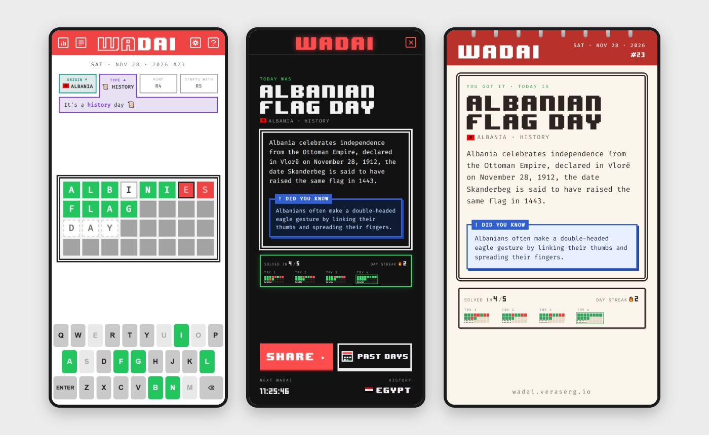

# WADAI



## :closed_book: Introduction
Welcome to **WADAI**, a daily word-guessing game with a global twist.

Each day, the game selects a festivity celebrated somewhere in the world on that date. Your challenge is to guess it in five tries.

Whether it’s Christmas, Diwali, 18 de Septiembre, or a national holiday you’ve never heard of, **WADAI** turns cultural discovery into a daily puzzle.

## :rocket: Features
- **A real celebration every day**: each day's answer is a festivity, holiday or national day celebrated somewhere in the world on that date.
- **5 tries, with clues**: correct letters stay on the board, and each miss unlocks a clue: the **origin** (country flag), the **type** of day, a **hint**, and the letter it **starts with**.
- **Learn something**: after each game you get the story of the day and a "Did you know?" fact.
- **Share your run**: SHARE makes a picture card with the day, the fact and your tries (colours only, no letters), plus a spoiler-free text.
- **Streaks & stats**: daily and best streak, games solved, how many tries you usually need, and a passport of the countries you've celebrated with.
- **Past days**: play any earlier day from the archive (it doesn't count toward your streak).
- **Three looks**: Classic, Arcade and Calendar themes, a colourblind palette and three text sizes.
- **No account, no server**: everything is saved in your browser.

## :hammer_and_wrench: Development
```bash
npm install
npm run dev     # http://localhost:5300
npm run build   # production build in dist/
npm run lint
```
React 18 + TypeScript + Vite, with zustand for state. The site is static and is deployed to GitHub Pages with the **Deploy WADAI** workflow (run it manually from the Actions tab).

## :link: Festivities
You can find the list of daily festivities: **[here](https://github.com/elsergiovera/wadai/tree/main/src/data/calendar)**

## :red_circle: Demo
You can find a live demo here: **[wadai.veraserg.io](https://wadai.veraserg.io)**
